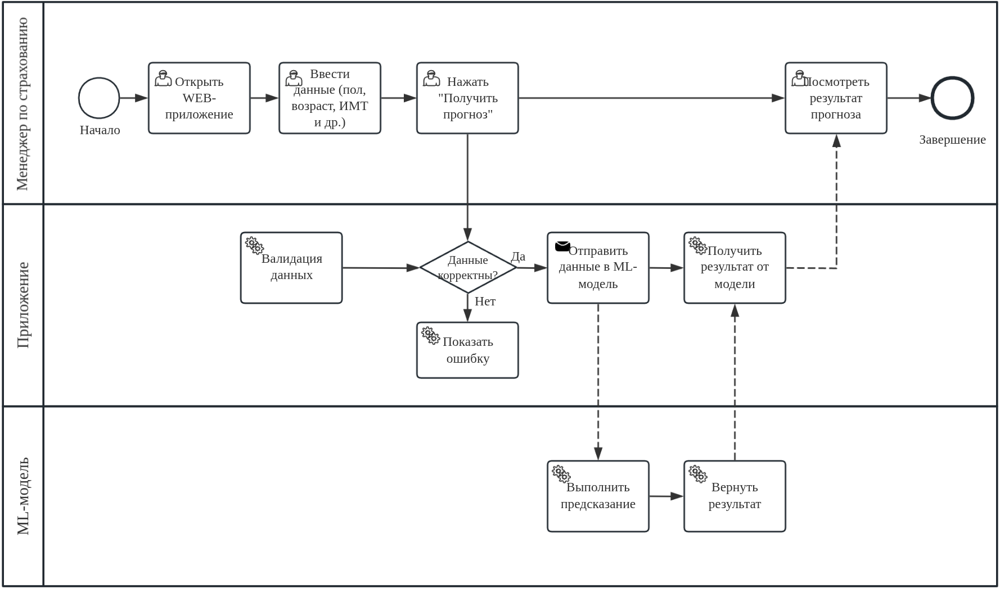

# BPMN-диаграмма бизнес-процесса «Оценка риска диабета и передача результата пользователю»
BPMN-диаграмма описывает бизнес-процесс получение оценки вероятности диабета пациента менеджером страховой компании.

Модель машинного обучения решает задачу оценки вероятности наличия диабета у потенциального или действующего клиента на основании его характеристик и медицинских показателей.

Менеджер по страхованию использует результат прогнозирования как дополнительную информацию при оценке страхового риска. Это помогает обратить внимание на клиентов, которым может потребоваться дополнительная проверка информации перед принятием решения о заключении договора страхования. Это необходимо, чтобы составить верную сумму страхового взноса, чтобы соблюсти баланс между переоценкой договора, когда клиент может уйти, и недооценкой договора, когда страховая компания остаётся в минусе.

Использовать ML целесообразно по следующим критериям:
- **Анализ множества факторов.** Модель может одновременно учитывать возраст, индекс массы тела, уровень глюкозы, гемоглобин и другие признаки.
- **Выявление сложных зависимостей.** Random Forest способен выявлять нелинейные связи между характеристиками клиента и целевым признаком, которые сложно оценивать вручную с помощью формул.
- **Автоматизация оценки.** Автоматический расчёт позволяет уменьшить время на обработку заявок.
- **Поддержка принятия решений.** Прогноз может помочь определить, в каких случаях стоит запросить дополнительную информацию или передать заявку на дополнительную проверку.

При этом ML не гарантирует безошибочную оценку. Результат зависит от качества обучающих данных и точности модели.

На вход модели поступают данные из анкеты пациента:
    - Пол пациента
    - Возраст пациента
    - Артериальная гипертензия (наличие)
    - Сердечно-сосудистые заболевания (наличие)
    - Курение
    - ИМТ
    - Гликированный гемоглобин
    - Уровень глюкозы в крови

Результат модели становится одним из входных факторов для дальнейшей работы менеджера со страховой заявкой.

Процесс можно описать следующим образом:
1. Получение заявки. Менеджер по страхованию получает заявление клиента на оформление медицинской страховки.
2. Сбор данных. Менеджер вводит необходимые характеристики клиента в приложение.
3. Проверка данных. Приложение проверяет полноту и корректность введённых значений.
4. Прогнозирование. Модель Random Forest рассчитывает вероятность диабета.
5. Получение результата. Приложение отображает прогноз менеджеру.
6. Дальнейшая обработка заявки. Менеджер рассматривает результат вместе с другими сведениями, предусмотренными процедурой оценки риска.
7. Принятие решения. При необходимости менеджер запрашивает дополнительные документы или передаёт заявку специалисту по оценке рисков. Окончательное решение принимается в совокупности факторов, а не только на основании прогноза модели.

Важно: прогноз модели не является медицинским диагнозом. Нельзя считать, что высокая предсказанная вероятность автоматически подтверждает наличие диабета.

## BPMN-диаграмма

