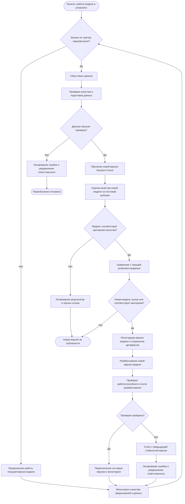

# Схема процесса автоматического переобучения

# Процесс переобучения
1. Мониторинг

На этапе мониторинга отслеживается качество предсказаний, изменение распределений признаков и поступление новых данных.
2. Триггер переобучения

Запускается процесс при достижении установленного порога ухудшения качества, обнаружении существенного сдвига данных или наступлении плановой даты.
3. Сбор данных

Получаются новые данные, которые соответствуют требованиям проекта.
4. Подготовка данных

Проверяются пропуски, дубликаты, типы данных, допустимые значения и соответствие ожидаемой структуре.
5. Обучение модели

Обучается новая версия Random Forest с использованием подготовленных данных.
6. Оценка качества

Модель проверяется на валидационной выборке, которая не участвовала в обучении.
7. Сравнение моделей

Результаты новой модели сравниваются с текущей production-версией
8. Сохранение модели

Сохраняются модель, метрики и параметры обучения.
9. Развёртывание

Новая модель размещается в production-среде.
10. Проверка после развёртывания

Проверяются загрузка модели, доступность сервиса и корректность предсказаний.

11. Откат

При ошибках восстанавливается предыдущая стабильная версия.

# Триггеры переобучения

- Плановое переобучение. Возможно раз в 1-3 месяцев при наличии новых данных и необходимости обновления модели.
- Снижение качества прогнозов. Recall опустилась ниже установленного порога.
- Изменение распределение признаков (data drift). Например возраста, BMI или уровня глюкозы, заметно отличается от обучающей выборки.

# Критерии переобучения

- Recall — основной критерий: новая модель не должна опускаться ниже установленного порога.
- Precision — дополнительный критерий, позволяющий контролировать количество ложноположительных предсказаний.
- ROC-AUC — дополнительная оценка способности модели различать классы.
- Технические проверки — модель загружается, принимает ожидаемые признаки и формирует корректные предсказания.

Метрики качества необходимо рассчитывать на данных, для которых уже известен фактический целевой признак. Если результаты обследований клиентов не поступают в систему, достоверно измерить текущий Recall на новых данных не получится. В таком случае можно контролировать drift и качество входных данных, но это не заменяет проверку качества прогнозов по известным результатам.

Таким образом, модель Random Forest переобучается планово раз в три месяца или внепланово при подтверждённом ухудшении качества, существенном изменении данных либо накоплении достаточного объёма новых размеченных примеров. После переобучения новая версия проходит независимую оценку и сравнение с действующей моделью. Если критерии качества не выполнены, новая версия отклоняется, а действующая модель продолжает использоваться.
